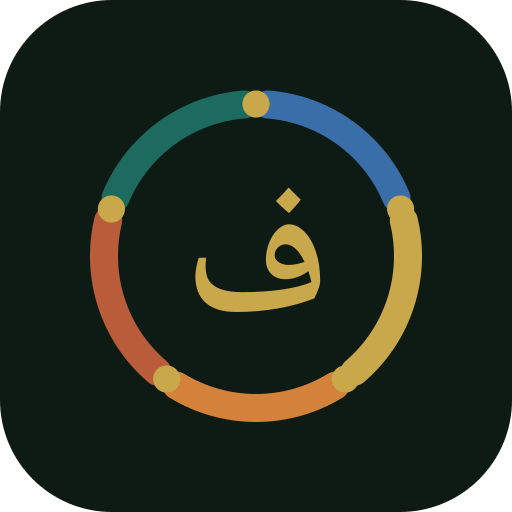
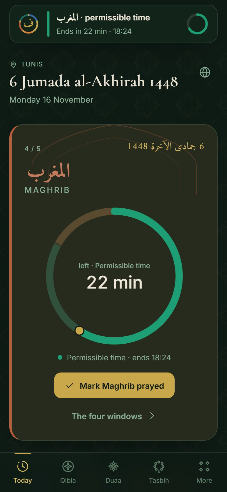
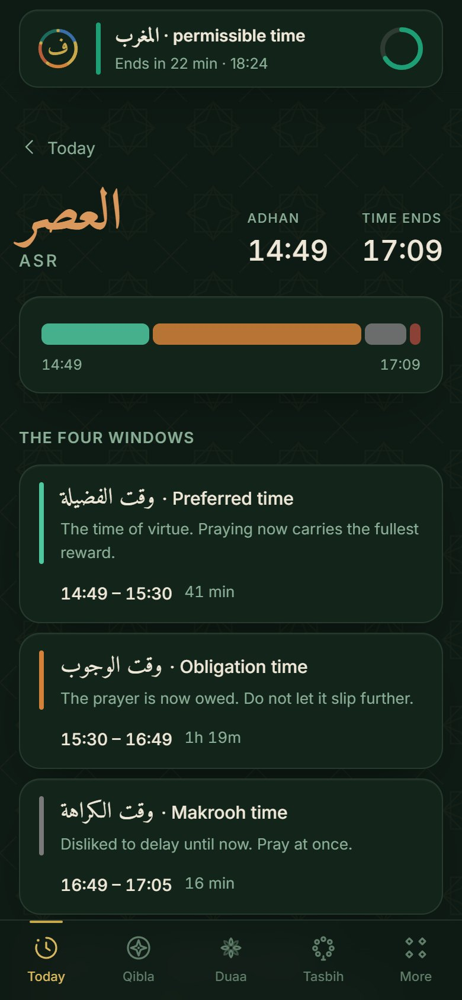
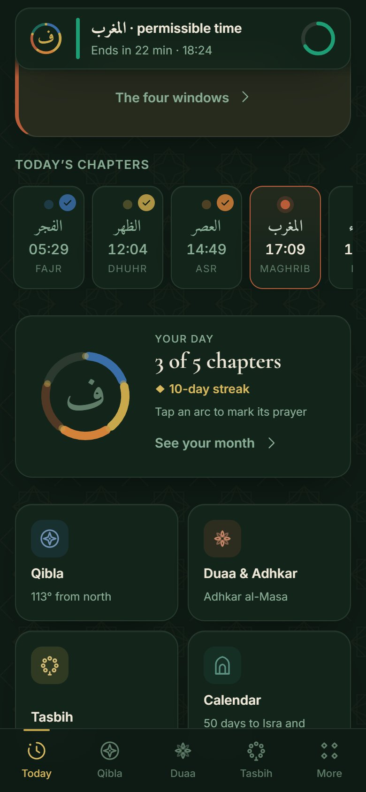
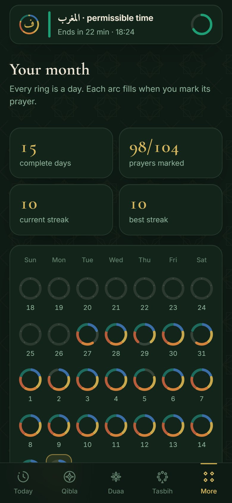
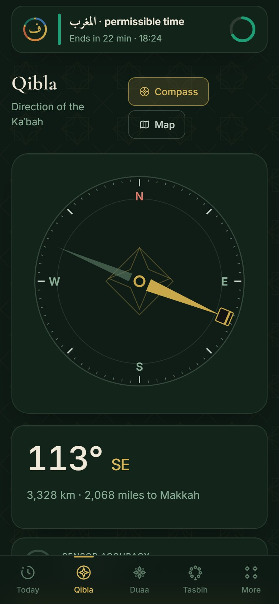
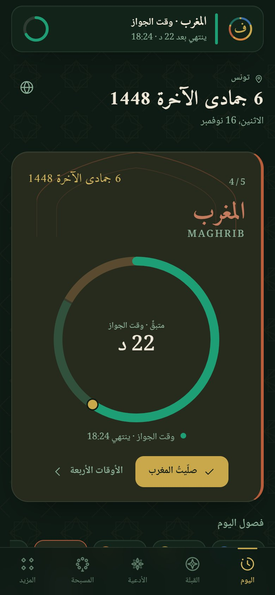
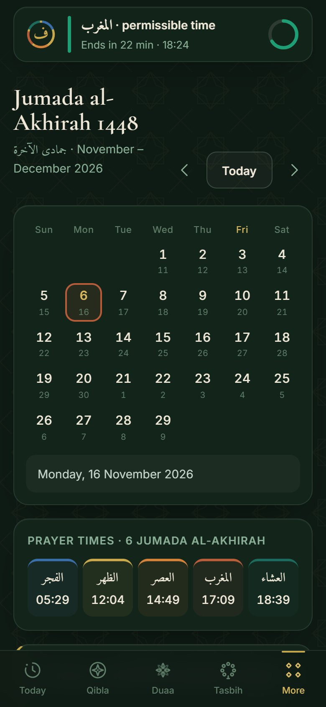
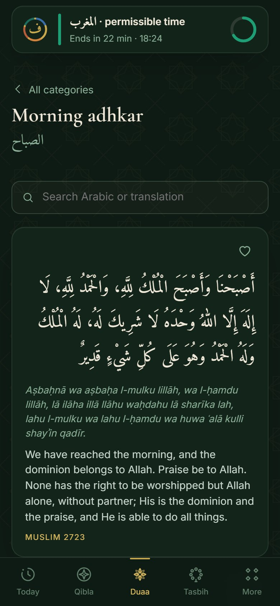
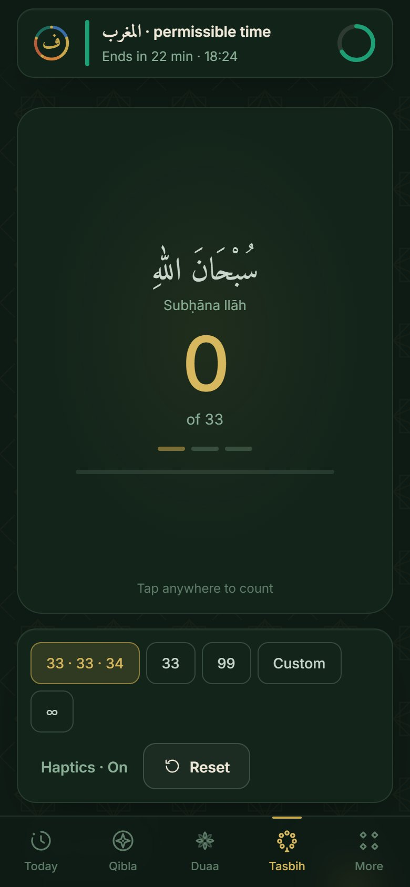

<div align="center">



# Fasl · فَصْل

**The Five Chapters of Your Day** · خمسة فصول في يومك

A prayer companion that treats time as a narrative, not a countdown.

[**Try the web app**](https://omario14.github.io/fasl/) · [**Download the Android APK**](https://github.com/omario14/fasl/releases/latest) · Arabic · Français · English · Türkçe

</div>

---

## The idea

*Fasl* (فَصْل) means a chapter, or the interval between two moments. Most prayer apps show five
times and fire an alarm at each one. Fasl starts from a different question: **where am I in my day
right now?**

You are always inside a chapter. Fasl tells you which one, how deep into it you are, and what it
asks of you, using the time windows the scholars of each madhab describe instead of a single
adhan time.

## What makes it different

| | A typical prayer app | Fasl |
|---|---|---|
| **Time display** | One adhan time per prayer | The whole window: preferred → permissible → obligation → makrooh |
| **Notification** | One alert at the adhan | An always-on status bar with a live countdown and an urgency colour |
| **Jurisprudence** | One method | Maliki, Hanafi, Shafiʿi, Hanbali and Jaʿfari, with 18 calculation methods |
| **Your progress** | Nothing, or a checklist | **The day ring**: the logo fills arc by arc as you pray, and becomes a month of rings |
| **Identity** | Generic | North African: zellige geometry, the zawiya arch, Naskh calligraphy |
| **Metaphor** | Clock and alarm | Five chapters of the day |

## Screenshots

<table>
  <tr>
    <td align="center"><br /><sub>The chapter you are in</sub></td>
    <td align="center"><br /><sub>Every window of a prayer</sub></td>
    <td align="center"><br /><sub>The day ring</sub></td>
  </tr>
  <tr>
    <td align="center"><br /><sub>A month of rings</sub></td>
    <td align="center"><br /><sub>Qibla compass and map</sub></td>
    <td align="center"><br /><sub>Arabic, right to left</sub></td>
  </tr>
  <tr>
    <td align="center"><br /><sub>Hijri calendar</sub></td>
    <td align="center"><br /><sub>Duaa and adhkar</sub></td>
    <td align="center"><br /><sub>Tasbih</sub></td>
  </tr>
</table>

## Features

**The prayer windows.** Each prayer is split into the windows of fiqh, calculated live from the
sun's position over you:

- **Fajr:** preferred, permissible, necessity, then makrooh just before sunrise
- **Dhuhr:** preferred in the first quarter of the afternoon, then permissible until Asr
- **Asr:** preferred until the shadow doubles, obligation until the sun yellows, makrooh, then forbidden as it sets
- **Maghrib:** preferred straight after sunset, permissible until the red twilight fades
- **Isha:** preferred in the first third of the night, recommended until midnight, necessity until dawn

**Always visible.** A status bar sits on every screen. It turns teal in the preferred time, amber
in the obligation time, red when you must pray now and grey in makrooh time. On Android it is also
a silent notification you can't swipe away, with a countdown that ticks and changes state by itself
while the app is closed.

**The day ring.** Fasl's mark is five arcs, one per prayer, each in the colour of the sky at that
hour. Tap an arc to mark its prayer and it fills in that colour. A complete day turns the ف gold.
Missed prayers show as dotted arcs, and *Your month* turns five weeks into a grid of rings with
streaks.

**Home-screen widgets (Android).** A 2×2 *Chapter* widget and a 4×2 *Today* widget, each with a
live countdown and your day ring.

**And the rest:**
- Qibla compass with a sensor accuracy meter, calibration guide and great-circle map
- Alerts at the adhan, the end of the preferred time, the obligation time and the makrooh time; each opens the screen it's about
- Duaa library with sources, morning and evening adhkar reminders, tasbih counter, the 99 Names, hadith of the day
- Hijri calendar with Islamic events, a Ramadan mode with suhoor, iftar and a 30-day tracker, and a qadha (missed prayer) tracker
- Nearby mosques from OpenStreetMap, saved for offline use
- Four languages with full right-to-left Arabic, dark *Forest Night* and light *Parchment* themes

## Privacy

Your location never leaves your device. Prayer times are calculated on the phone, there is no
account and no analytics, and the app works offline. The only network requests are map tiles and
the optional mosque search, both from OpenStreetMap.

## Try it

- **On any phone or computer:** open **[omario14.github.io/fasl](https://omario14.github.io/fasl/)**. On a phone, use *Add to Home screen* to install it.
- **On Android, with widgets and native notifications:** download `Fasl.apk` from the [latest release](https://github.com/omario14/fasl/releases/latest), open it and allow installing from this source.

## How it's built

| Layer | Choice |
|---|---|
| App | React 19, TypeScript, Vite |
| Prayer astronomy | [adhan-js](https://github.com/batoulapps/adhan-js), with Fasl's own window engine on top (`src/core/prayer.ts`) |
| Hijri dates | `Intl` Umm al-Qura calendar, ±2 day sighting adjustment |
| Android | Capacitor 8, plus native Java for the live status notification, widgets and ring rendering (`android/app/src/main/java`) |
| Maps | Leaflet with OpenStreetMap tiles; Overpass API for mosques |
| Fonts | Amiri, Noto Naskh Arabic, Cormorant Garamond and Inter, bundled for offline use |

```
src/
  core/       prayer engine, status states, alerts, Hijri, day rings, native bridge
  features/   screens: Today, prayer detail, Qibla, Duaa, Tasbih, calendar, rings, settings…
  ui/         the mark, rings, status bar, icons, shared controls
  i18n/       Arabic, French, English, Turkish
android/      Capacitor project with the native status bar and widgets
```

### Run it locally

```bash
npm install
npm run dev          # http://127.0.0.1:5180
```

### Build the Android app

Needs the Android SDK and JDK 21 (Android Studio ships both).

```bash
npm run build
npx cap sync android
cd android && ./gradlew assembleDebug
```

## Roadmap

- Licensed muezzin recordings for the adhan (alerts use the system sound today)
- Prayer silence: Do Not Disturb for a set time after each adhan
- Travel mode with shortened and combined prayers
- Urdu, Indonesian and Bengali
- Mark prayers straight from the widget
